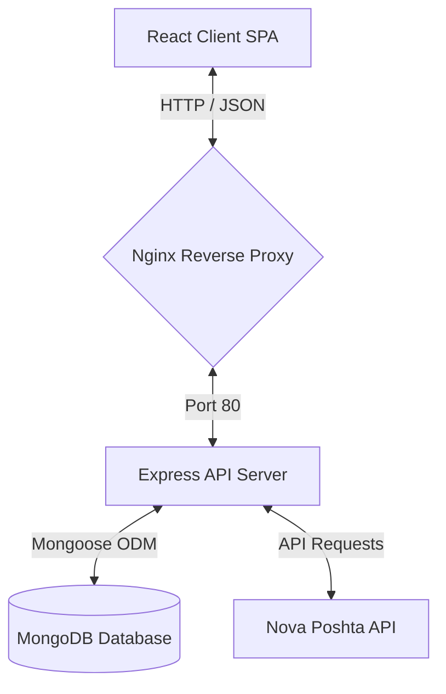

<p align="center"><a href="README.md">English</a> | <b>Українська</b></p>

# <p align="center"></p>

<p align="center">
  
</p>

<p align="center">
  <strong>Сучасна full-stack платформа електронної комерції на стеку MERN</strong>
</p>

<p align="center">
  
  
  
  
  
</p>

<p align="center">
  
  
</p>

---

## Огляд

**Nexora** — функціональна full-stack платформа електронної комерції на стеку MERN, створена для демонстрації сучасних практик веб-розробки. Застосунок поєднує адаптивну інтерактивну клієнтську частину магазину (SPA) з багатофункціональною панеллю адміністратора: статистика продажів, модерація контенту та інтеграція з API Нової Пошти для розрахунку доставки.

Систему оптимізовано для чистої модульності, безпечної обробки даних і розгортання в контейнерах у різних середовищах.

---

## Цілі проєкту

Проєкт розроблено як дипломна робота та практичну реалізацію сучасної платформи електронної комерції на стеку MERN.

Основні завдання:
* Проєктування масштабованої клієнт-серверної архітектури.
* Реалізація рольового контролю доступу (RBAC).
* Розробка адаптивного SPA-інтерфейсу.
* Створення системи адміністративного управління.
* Інтеграція із зовнішньою службою доставки (API Нової Пошти).

---

## Архітектура системи

Проєкт реалізує розділену клієнт-серверну архітектуру з чітким розподілом відповідальності:
1. **Frontend (SPA)**: побудований на React 19, асинхронно взаємодіє з бекендом через RESTful-ендпоїнти.
2. **Backend (API)**: на базі Express.js, відповідає за автентифікацію, валідацію запитів і бізнес-логіку комерції.
3. **База даних**: MongoDB з Mongoose ODM для схем і валідації полів.
4. **Проксі та маршрутизація**: Nginx виступає як reverse proxy, направляючи запити клієнта або до статичних файлів, або до API бекенду, і приховує внутрішні порти.



---

## Галерея інтерфейсу

<table align="center">
  <tr>
    <td align="center"><b>Головна сторінка</b></td>
    <td align="center"><b>Каталог товарів</b></td>
  </tr>
  <tr>
    <td><a href="public/assets/screenshots/Home Page.png"></a></td>
    <td><a href="public/assets/screenshots/Catalog Page.png"></a></td>
  </tr>
  <tr>
    <td align="center"><b>Багатокрокове оформлення замовлення</b></td>
    <td align="center"><b>Панель адміністратора</b></td>
  </tr>
  <tr>
    <td><a href="public/assets/screenshots/Checkout Page.png"></a></td>
    <td><a href="public/assets/screenshots/Admin Dashboard.png"></a></td>
  </tr>
</table>

---

## Ключові можливості

### Магазин і досвід покупця
* **Глобальний пошук**: розумний рядок пошуку в навігації з підказками в реальному часі та історією запитів.
* **Реактивні фільтри каталогу**: динамічне сортування та фільтрація за категоріями, брендами, ціновим діапазоном і користувацькими атрибутами без перезавантаження сторінки.
* **Порівняння товарів**: окрема таблиця для порівняння технічних характеристик до 4 товарів одночасно.
* **Списки бажань**: збереження товарів у кількох папках зі власними назвами.
* **Інтерактивне оформлення замовлення**: автоматичний вибір міста та відділення, синхронізований з офіційним API Нової Пошти.
* **Кабінет клієнта**: історія замовлень, статуси доставки, відгуки та запитання.

### Адміністрування та операції
* **Панель аналітики**: статистика продажів і моніторинг замовлень.
* **Керування каталогом**: повний CRUD для товарів, брендів і категорій (із успадкуванням шаблонних атрибутів).
* **Система знижок**: підтримка акційних цін із правилами перевірки для початкової та знижкової ціни.
* **Життєвий цикл замовлення**: відстеження статусів (Нове, Підтверджене, Пакування, Готове до видачі, Отримане, Скасоване) з історією змін.
* **Модерація контенту**: перегляд, схвалення та відхилення відгуків і запитань клієнтів з офіційними відповідями персоналу.
* **Журнал аудиту**: журнал адміністративних дій для відстеження змін.

---

## Демо-доступ

Для швидкої перевірки панелі адміністратора (спершу наповніть базу даних):

| Роль | Логін | Пароль |
| :--- | :--- | :--- |
| Admin | `admin` | `admin123` |

---

## Технологічний стек

| Компонент | Технологія | Призначення |
| :--- | :--- | :--- |
| **Frontend** | React 19, Vite 8, React Router DOM (v7), Context API | Single Page Application, керування станом |
| **Стилізація** | Sass (SCSS) | Модульні стилі інтерфейсу |
| **Backend** | Node.js, Express.js | Stateless RESTful API-сервер |
| **База даних** | MongoDB, Mongoose | Документна база даних, ODM |
| **Проксі / сервер** | Nginx | Reverse proxy, хостинг статичних файлів, SSL-маршрутизація |
| **Контейнеризація** | Docker, Docker Compose | Оркестрація багатоконтейнерного середовища |

---

## Розгортання через Docker (рекомендовано)

Щоб запустити весь стек (база даних, бекенд, фронтенд, Nginx) локально через Docker Compose:

```bash
docker compose up -d --build
```

Сервіси:
* **Frontend**: [http://localhost](http://localhost) (Nginx proxy, порт 80)
* **Backend API**: [http://localhost:5000](http://localhost:5000)
* **MongoDB**: `localhost:27018`

Щоб зупинити контейнери та видалити мережу:
```bash
docker compose down
```

---

## Локальне середовище розробки

Щоб запустити dev-сервери клієнта та сервера безпосередньо на своїй машині:

### 1. Встановлення залежностей
Встановіть залежності для клієнта і сервера:
```bash
npm install && cd server && npm install && cd ..
```

### 2. Налаштування змінних середовища
Скопіюйте демонстраційну конфігурацію в активне середовище сервера:
* **Windows (PowerShell)**:
  ```powershell
  Copy-Item .env.demo -Destination server/.env
  ```
* **Linux/macOS**:
  ```bash
  cp .env.demo server/.env
  ```

### 3. Запуск dev-серверів
Запустіть обидва dev-сервери одночасно:
```bash
npm run dev:full
```
Інтерфейс клієнта буде доступний за адресою [http://localhost:3000](http://localhost:3000).

---

## Наповнення та резервне копіювання бази даних

Ініціалізуйте базу даних попередньо налаштованими товарами, категоріями, відгуками та тестовими користувачами.

> [!WARNING]
> Команда наповнення бази видаляє наявні колекції в підключеній MongoDB.

Щоб наповнити базу:
```bash
npm run seed
```

Щоб зберегти поточний стан локальної бази у файли конфігурації наповнення (JSON у `server/data/`):
```bash
node server/scripts/export.js
```
